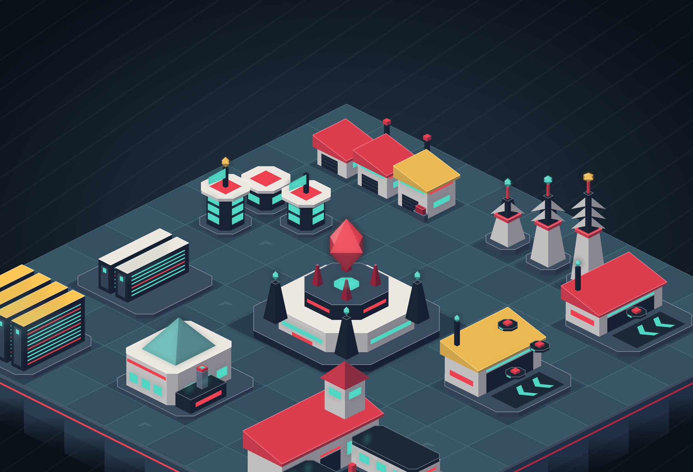

# StartupClicker

A clicker game where you are a founder building a near-future tactical-tech agency.
It mixes three things:

- **Clicker mechanics** – click the Command Core for credits, buy buildings that earn passively, stack upgrades.
- **Isometric base building** – place, move, upgrade and sell buildings on a diamond grid.
- **A flat, angular art style** – hard-edged shapes, red / navy / cream palette with teal glow.



## Running it

1. Open the project in **Unity 6000.6.5f1** (Unity Hub → Add → this folder).
2. Open `Assets/Scenes/SampleScene.unity` and press **Play**.

There is nothing to set up in the scene. `Bootstrap.cs` builds the world, camera rig and UI from code when Play starts.

On first import Unity creates `.meta` files for the new assets – commit them.

## Controls

| Action | Input |
| --- | --- |
| Earn credits | Click the Command Core (centre of the map) |
| Build | Pick a building in the **BUILD** tab, click a tile. Hold **Shift** to keep building |
| Select a building | Click it → **Upgrade / Move / Sell** |
| Cancel / deselect | Right-click or **Esc** |
| Pan | Drag with any mouse button, or **WASD** / arrow keys |
| Zoom | Mouse wheel |
| Supply drop | Click the crate when it appears: bonus credits or a x7 frenzy |

Upgrading the **Command Core** (button under the credits) doubles click power and unlocks new buildings.
Progress autosaves, and you earn at half rate for up to 8 hours while the game is closed.

## How the code is organised

```
Assets/Scripts/Core/   Game rules. Plain C#, no Unity types – unit-testable on its own.
  Catalog.cs           All balance data: buildings, costs, upgrades.
  GameSim.cs           Buy / move / upgrade / sell / click / tick. The only code that changes game state.
  GameState.cs         What gets saved.
  GridModel.cs         Which building occupies which cell.
  NumberFormat.cs      1234567 -> "1.23M".
Assets/Scripts/Game/   Unity layer: shows the state and turns input into GameSim calls.
  Bootstrap.cs         Entry point – creates everything at runtime.
  GameController.cs    Input, placement / move modes, supply drops, saving.
  WorldView.cs         Ground tiles, building sprites, placement ghost, picking.
  IsoGrid.cs           Grid <-> world maths and draw order.
  CameraController.cs  Pan / zoom.
  SpriteBank.cs        Loads PNGs from Resources and builds Sprites with the right pivots.
  Fx/                  Tweens, squash-and-stretch, shard particles, sound.
  UI/                  HUD built in code (uGUI).
Assets/Tests/EditMode/ NUnit tests for the Core rules (Window → General → Test Runner).
Tools/art/             Python scripts that generate every sprite and sound.
```

To change balance, edit `Catalog.cs`. To add a building: add it to `Catalog.Buildings`, add a recipe with the
same id in `Tools/art/generate_art.py`, and regenerate the art.

## Regenerating art and sound

All art is drawn by code, so the whole look can be retuned from one palette.

```bash
pip install pillow
```

```bash
python3 Tools/art/generate_art.py --preview
```

```bash
python3 Tools/art/generate_sfx.py
```

`iso.py` holds the palette and the isometric drawing primitives; `generate_art.py` holds one recipe per building.
`--preview` also writes `Tools/art/preview.jpg` (mock scene) and `Tools/art/sheet.jpg` (every building at every level).

## Credits

Font: [Barlow Condensed](https://github.com/jpt/barlow) – SIL Open Font License (see `Assets/Resources/Fonts/BarlowCondensed-OFL.txt`).
